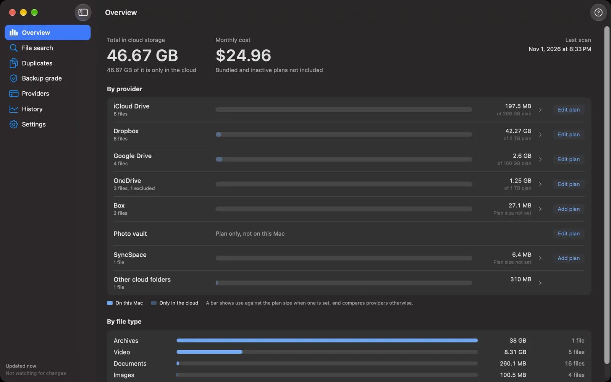

# Cloudpane

Cloudpane is a free macOS app from 404 Cybersecurity LLC that shows where your cloud storage
goes across iCloud Drive, Dropbox, Google Drive, OneDrive and Box. One scan of the cloud
folders already on your Mac answers five questions: how much each service holds, where a file
lives, what is stored twice, how well it is backed up, and what each plan costs per terabyte.

Cloudpane reads the folders that each provider's desktop app already keeps on your Mac. It
needs no logins and makes no network connections of its own, and it never moves, copies,
deletes or uploads a file. It never reads or downloads a file's contents either, with one
opt-in exception: hashing a cloud-only file to find exact duplicates needs its contents, so
you turn hashing on per folder and Cloudpane says plainly that it will download. Reading a
folder the provider has not listed on the Mac yet may make the provider's app fetch that
folder's list of files, and the provider may then download items it keeps on the Mac by its
own policy (OneDrive did this for a OneNote notebook shortcut in testing), the same as after
you open the folder in Finder.

The design depends on one assumption: a file stored only in the cloud leaves a placeholder on
the Mac that still reports the file's real size, so a full inventory costs no bandwidth. The
real-provider run recorded in `Spike/RESULTS.md` confirmed it for Dropbox, Google Drive,
OneDrive and Box on one Mac, and for iCloud Drive with a test file. The `Spike/` folder holds
the script.



The screenshot shows the app's built-in demo data.

## Install

Cloudpane is signed with a Developer ID certificate and notarized by Apple. Pick one:

- Download `Cloudpane-<version>.zip` or `Cloudpane-<version>.dmg` from the
  [latest release](https://github.com/breed007/Cloudpane/releases/latest) and move
  Cloudpane to your Applications folder. `SHA256SUMS.txt` on the same page lists the
  SHA-256 of both files; compare with `shasum -a 256 <file>`.
- With Homebrew: `brew install --cask breed007/tap/cloudpane`
- Build it yourself; see [Building from source](#building-from-source).

## What it does

- Overview: totals per provider and account, split into what is on this Mac and what is only
  in the cloud, with a note when a provider has not finished listing its folder on the Mac.
- File search: search every provider by file name. Reveal in Finder and Copy path are the
  only actions on a file.
- Duplicates: groups ranked by reclaimable space, matched by name, size and date, by size
  alone for large files, or by SHA-256 for folders with hashing turned on.
- Backup grade: a 3-2-1 letter per top-level folder and overall, with reasons. Sync is not backup,
  so another cloud copy never raises the grade; a backup location you add (Time Machine, an
  external drive, a NAS share) does.
- Providers: every account on the Mac with its status and space used, and one plan per
  provider entered once by hand, normalized to a monthly cost, with cost per
  terabyte, room left, months to full, consolidation options and bundles kept apart. For
  iCloud, an optional Photos estimate from the Photos library's size and a total you can
  enter from System Settings. Add provider explains how a supported service shows up,
  tracks a plan with no folder on the Mac (its cost counts, nothing else), or gives a
  provider name to an unrecognized folder in `~/Library/CloudStorage`. Each row's menu
  removes a plan, excludes an account from scans or includes it again, forgets an account
  that is gone, or removes a provider you added. These change only Cloudpane's own records,
  never a provider app or a file.
- History: every scan is kept, and a file watcher records changes as they happen.
- Export: a scan as CSV or JSON, or a PDF report that leaves out paths and names by default.

The in-app help (Help > Cloudpane Help, ⌘?) is the set of pages in
[`docs/help`](docs/help), bundled as they are; [`docs/help/README.md`](docs/help/README.md)
explains the front matter and the Mac-only section markers.

## What it never does

- Write to, move, delete or upload your files. Every folder grant is read-only.
- Read or download a file's contents. Hashing for exact duplicates is the one exception,
  and only for folders you turn it on for. Listing a folder may make the provider's app
  fetch that folder's list of files, and the provider may then download items it keeps on
  the Mac by its own policy, as it would after you open the folder in Finder.
- Connect to the network. The app has no network entitlement.
- Ask for an Apple Account or any other login, or use a provider's API.
- Read Mail or Messages, which need Full Disk Access, or read photos. The Photos estimate adds
  up file sizes inside the library; PhotoKit is not used.
- Collect anything. There are no analytics, crash reporting or third-party SDKs.

## Verify what it can do

You do not have to take the list above on trust. macOS enforces what a sandboxed app may do
from the entitlements in its signature, and you can read them:

```sh
codesign -d --entitlements - /Applications/Cloudpane.app
```

It prints four entitlements:

- `com.apple.security.app-sandbox`: Cloudpane runs in the App Sandbox, which denies
  everything the other three do not allow.
- `com.apple.security.files.user-selected.read-only`: it can read a folder you pick in an
  open panel, and cannot write to it.
- `com.apple.security.files.bookmarks.app-scope`: it can remember the folders you picked
  between launches.
- `com.apple.security.files.downloads.read-write`: it can write to your Downloads folder,
  where exports and reports go.

There is no `com.apple.security.network.client` entitlement, so the sandbox blocks any
connection Cloudpane tries to make. To see who signed the app, run
`codesign -dvv /Applications/Cloudpane.app`; the first Authority line reads
`Developer ID Application: 404 Cybersecurity LLC (YA83Q8FTH3)`.

## Requirements

- macOS 14 (Sonoma) or later, on Apple silicon or Intel.
- Each provider must be installed and signed in on the Mac you scan, using its current desktop
  integration. Cloudpane cannot see a service you use only in a web browser or on another
  device.

What each provider needs before it appears:

| Provider | What must be set up | Where it shows up |
| --- | --- | --- |
| iCloud Drive | iCloud Drive turned on in System Settings, under your name, then iCloud. This is a system setting, not an app. | `~/Library/Mobile Documents/com~apple~CloudDocs` |
| Dropbox | The Dropbox desktop app, signed in, using the `~/Library/CloudStorage` location. Older installs that keep files in `~/Dropbox` are not seen. | `~/Library/CloudStorage/Dropbox` |
| Google Drive | Google Drive for desktop, signed in. | `~/Library/CloudStorage/GoogleDrive-<account>` with `My Drive` and `Shared drives` inside |
| OneDrive | The Microsoft OneDrive app, signed in, with Files On-Demand. Each account gets its own folder. | `~/Library/CloudStorage/OneDrive-Personal` or `OneDrive-<organization>` |
| Box | Box Drive, signed in. | `~/Library/CloudStorage/Box-Box` |

Notes on these setups:

- iCloud Drive: with Optimize Mac Storage turned on, macOS keeps files local until the Mac
  needs the space, then removes the local copies of files you have not opened recently and
  leaves placeholders that keep each file's name, size and dates. On a Mac with plenty of free
  space, few or no files may be placeholders. With it off, macOS keeps every file on the Mac
  unless you choose Remove Download on a file or folder yourself, which leaves a placeholder
  the same way. If Desktop and Documents Folders is turned on, those two folders live inside
  iCloud Drive and count toward it.
- Dropbox: files set to online-only become placeholders. The move from `~/Dropbox` to
  `~/Library/CloudStorage` happens inside the Dropbox app; which Dropbox versions and account
  types have made it is to be verified.
- Google Drive: streaming mode keeps files in the cloud with local placeholders. Whether
  mirroring mode keeps `My Drive` under `~/Library/CloudStorage` or in a separate folder is
  to be verified.
- OneDrive: folders turned off under "Choose folders" are hidden from the Mac, so Cloudpane
  sees only part of that account. Whether Files On-Demand can still be turned off in current
  OneDrive versions is to be verified.
- Box: Box Drive streams everything by default, so most files are placeholders until opened
  or marked for offline use.

## Updates

Cloudpane never checks for updates, because it cannot go online. To update, run
`brew upgrade --cask cloudpane` if you installed it with Homebrew, or download the new
release and replace the app. [CHANGELOG.md](CHANGELOG.md) lists what changed. Your inventory
and settings are kept.

## Removing Cloudpane

Quit Cloudpane, move it to the Trash (or run `brew uninstall --cask cloudpane`), then delete
its container, which holds the inventory database and settings:

```sh
rm -rf ~/Library/Containers/com.404tools.cloudpane
```

Exports and reports you saved to Downloads stay there until you delete them.

## Reporting bugs

Open an issue at https://github.com/breed007/Cloudpane/issues. Cloudpane sends no crash
reports, so an issue is the only way we hear about a problem. Leave out real file names,
folder names and account email addresses, or replace them with made-up ones.

## Building from source

Requirements: Xcode 27.1 or later and [XcodeGen](https://github.com/yonaskolb/XcodeGen)
(`brew install xcodegen`).

```sh
git clone https://github.com/breed007/Cloudpane.git
cd Cloudpane
xcodegen generate
open Cloudpane.xcodeproj
```

The scanning engine is the [CloudpaneCore](https://github.com/breed007/CloudpaneCore) Swift
package. Xcode fetches it from GitHub at the exact version pinned in `project.yml`; there is
nothing to check out by hand.

`project.yml` is the source of the Xcode project. After changing it, run `xcodegen generate`
and commit both. Do not edit `Cloudpane.xcodeproj` by hand.

Signing: `DEVELOPMENT_TEAM` in `project.yml` is 404 Cybersecurity LLC's team, which you
cannot sign with. In Xcode, choose your own team under Signing & Capabilities. From the
command line, this builds with ad hoc signing and no team:

```sh
xcodebuild build -project Cloudpane.xcodeproj -scheme Cloudpane -configuration Debug \
  CODE_SIGN_IDENTITY=- DEVELOPMENT_TEAM= CODE_SIGN_STYLE=Manual
```

The app is sandboxed with four entitlements and nothing else: the App Sandbox, read-only
access to folders the user picks, app-scope bookmarks to keep that access between launches,
and read-write access to Downloads, where exports go. It has no network entitlement.

On first run the app asks for two folders, `~/Library/CloudStorage` and
`~/Library/Mobile Documents/com~apple~CloudDocs`, through the standard open panel. A folder
that does not exist on the Mac can be skipped; its providers show as not installed. Backup
locations (a Time Machine backup, an external drive, a NAS share) are added in Settings
through the same open panel, read-only, and so is the Photos library if you choose it in
Providers. The inventory database, including plans and backup
locations, lives in the app's container.

The build number (`CFBundleVersion`) is the build time, `YYYYMMDD.HHMM`, stamped by a build
phase on every build. The version (`MARKETING_VERSION`) is set by hand in `project.yml`.

Tests: the Cloudpane scheme runs `CloudpaneTests`, which exercise the app's model against a
made-up home folder in a temporary directory, never the app's own container. CloudpaneCore's
own tests run with `swift test` in its repository.

Debug builds have a demo mode for screenshots (`-CloudpaneDemo`), described in
[`docs/screenshots.md`](docs/screenshots.md). It is compiled out of Release builds.

Releases are built by `scripts/release.sh`, which signs, checks the result (the four
entitlements, no demo mode, both architectures), notarizes and packages it.
[`docs/release-checklist.md`](docs/release-checklist.md) has the steps around it, and
[`docs/privacy-policy.md`](docs/privacy-policy.md) is the privacy policy.

## Running the spike

The spike needs only the Swift toolchain that ships with Xcode or the Command Line Tools.

```sh
# Scan the real provider folders and print per-provider totals.
swift Spike/footprint-spike.swift

# Same scan with account names, file names and attribute values replaced by placeholders,
# suitable for pasting into Spike/RESULTS.md.
swift Spike/footprint-spike.swift --redact

# Scan a different home directory, for example the fake tree described below.
swift Spike/footprint-spike.swift --home /path/to/fake-home

# Let each provider fetch the listing of folders it has not listed on this Mac yet. The
# spike never reads file contents; a check at the very end reports any cloud-only file that
# gained local data during the run, with when it did.
swift Spike/footprint-spike.swift --redact --allow-folder-listing
```

With `--allow-folder-listing`, the provider apps fetch folder listings over the network, the
same as when you open those folders in Finder. A large account can take a while the first
time. A provider may also download items it keeps on the Mac by its own policy once it
knows about them; the final check lists any such file with its change time, so it can be
matched with the provider's logs.

To test the script on a Mac without any providers installed, build a fake home that mimics the
same folder layout and check the spike's output against the numbers it was built to produce:

```sh
bash Spike/make-fake-tree.sh /path/to/fake-home
sh Spike/check-fake-tree.sh /path/to/fake-home
```

`make-fake-tree.sh` never deletes anything. It only accepts a path that does not exist yet
(it creates the folder) or an empty directory it can read and list, and it refuses symbolic
links and everything else, including your home folder. Use a scratch location such as a folder
under `/tmp`. To rebuild, remove the folder yourself first. The tree contains one deliberately
unreadable folder, so restore its permissions before removing it:

```sh
chmod u+rwx /path/to/fake-home/Library/CloudStorage/OneDrive-Contoso/Shared/locked
rm -rf /path/to/fake-home
```

The fake tree uses sparse files to stand in for placeholders. It cannot reproduce what a real
provider sets on its files; `Spike/RESULTS.md` lists what it can and cannot show.

Keep unredacted output in `Spike/RESULTS-local.md`, which is ignored by git.

## License

Cloudpane is released under the MIT License; see [LICENSE](LICENSE). It uses only Apple's
frameworks and has no third-party dependencies.
